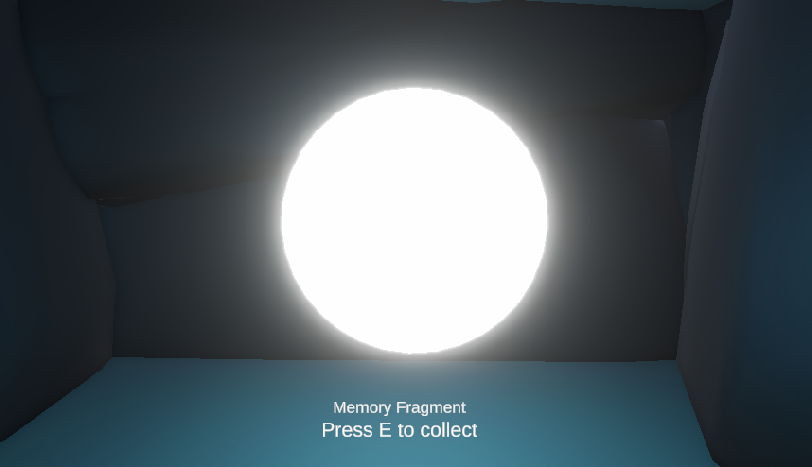
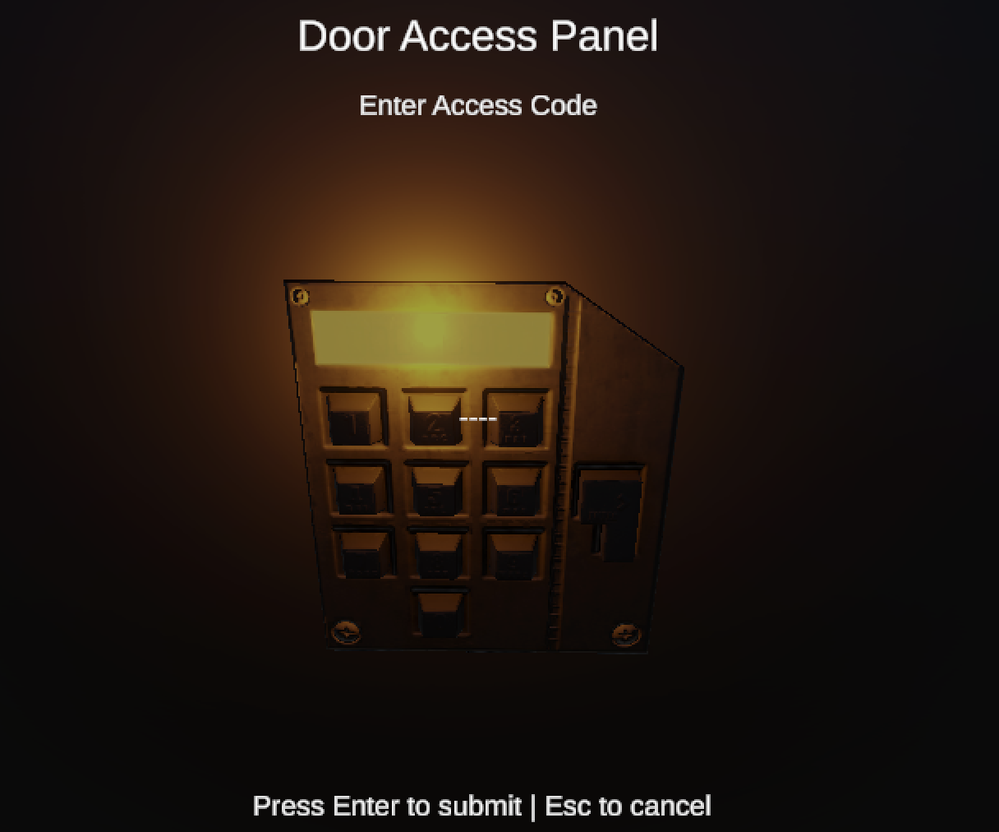
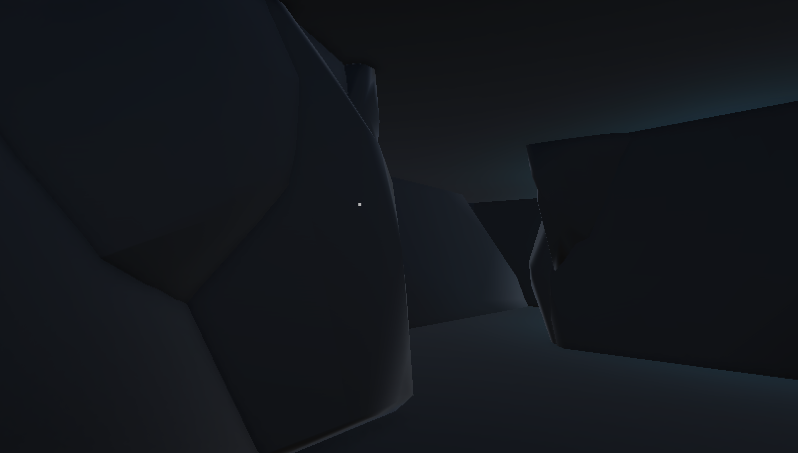
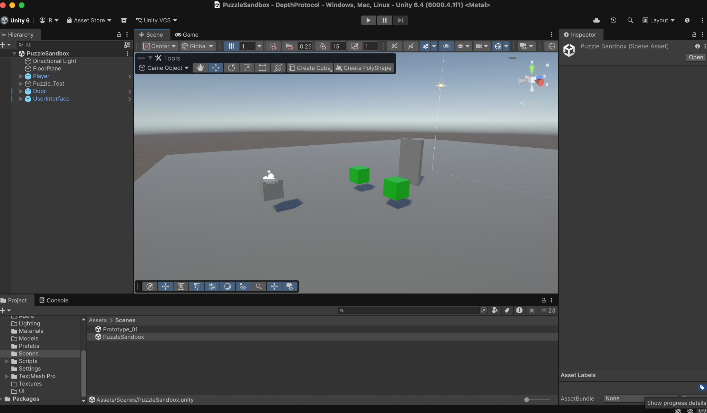

# Depth Protocol

**A first-person underwater exploration prototype built with Unity and C#.**

Depth Protocol is a personal game development project set in an underwater cave system with mysterious technological ruins. I started it to practice C# programming and learn how to build and connect gameplay systems in Unity.

The current prototype has a working exploration loop. I'm also developing and testing additional puzzle mechanics in a separate sandbox scene before integrating them into the main level.

## Screenshots

| Memory fragment interaction | Code-locked door |
| --- | --- |
|  |  |

| Underwater cave prototype | PuzzleSandbox test scene |
| --- | --- |
|  |  |

## Playable Prototype

The main scene currently has a complete gameplay loop:

1. Explore an underwater cave and find a locked door.
2. Search a side path for a memory fragment.
3. Read the fragment to discover an access code.
4. Return to the door, enter the code, and unlock the path forward.

## Systems I've Built

**Player movement**
- Rigidbody-based floating movement with camera-relative WASD controls
- Vertical movement, smooth acceleration, and sprinting with an FOV change
- Mouse look with pitch limits and camera tilt

**Interaction and UI**
- SphereCast-based detection of nearby interactable objects
- Reusable C# interaction components and context-sensitive prompts
- Memory fragment panels, a reactive reticle, and a code-entry interface

**Doors and puzzles**
- Code-locked doors with keypad-style input
- Door unlocking logic separated from door movement
- Puzzle manager and switches for tracking puzzle conditions

## PuzzleSandbox

I use a separate `PuzzleSandbox` scene to build and test new puzzle elements before adding them to the main prototype. The scene includes working switches connected to a puzzle manager. Keeping experimental mechanics separate makes it easier to test behavior and troubleshoot issues without changing the main gameplay loop.

## Tools and Technical Focus

- **Engine:** Unity
- **Language:** C#
- **Other tools:** Unity Physics, ProBuilder, Unity Asset Store environment assets
- **Skills practiced:** Object-oriented programming, modular gameplay systems, UI interactions, testing, and debugging

## Opening the Project

1. Clone or download this repository.
2. Open the project folder in Unity Hub.
3. Use the Unity Editor version indicated in `ProjectSettings/ProjectVersion.txt`, or a compatible version.
4. Open the main gameplay scene in `Assets/Scenes/` and enter Play mode.
5. To explore the puzzle testing environment, open `Assets/Scenes/PuzzleSandbox.unity`.

This is a Unity project rather than a packaged standalone game build.

## Project Status

**Early playable prototype.** The memory-fragment and code-door loop works, and puzzle switches are functional in the separate sandbox scene. Future work includes expanded environments, sound, additional puzzles, and visual polish.

## Author

**Izaiah Razon**  
Computer Engineering student, University of Hawaiʻi at Mānoa
